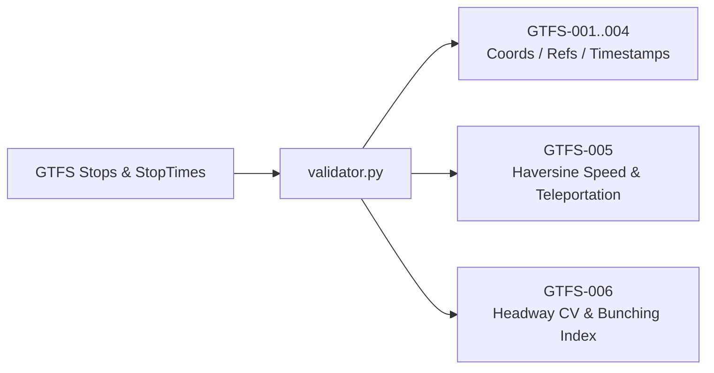

# gtfs-audit

[](https://github.com/codesphere-u/gtfs-audit/actions/workflows/ci.yml)
[](LICENSE)
[](pyproject.toml)
[](pyproject.toml)

**Zero-dependency GTFS & informal paratransit (matatu/trotro/bus) feed validator: Haversine inter-stop speed/teleportation detector, headway regularity CV & bus-bunching index, and service-span auditor.**

- **Mission Domain:** Transportation, Paratransit & Urban Mobility
- **Stack:** Pure Python 3.11+ (zero runtime third-party dependencies, `mypy --strict`, `ruff`, `pytest`)
- **Maintainer:** Codesphere Innovations (U) Limited (`codesphere-u`)

---

## Problem Solved

African cities mapping informal matatu, trotro, danfo, and bus networks into GTFS feeds frequently ship broken coordinates, impossible inter-stop speeds, and unmeasured headway bunching that breaks rider trip planners.

## Key Features

- GTFS `HH:MM:SS` parser supporting post-midnight service hours (`>= 24:00:00`) and strict stop/trip referential integrity (`GTFS-001`..`GTFS-004`).
- Great-circle Haversine inter-stop speed and zero-second teleportation detector (`GTFS-005`).
- Per-route headway regularity coefficient of variation (`headway_cv`), bus-bunching counter (`< 50%` mean headway), and service-span calculator (`GTFS-006`).

## Architecture Overview



See [docs/architecture.md](docs/architecture.md) for module-level design details.

## Installation

```bash
git clone https://github.com/codesphere-u/gtfs-audit.git
cd gtfs-audit
uv sync --extra dev
```

Or install in editable mode with standard `pip`:

```bash
pip install -e ".[dev]"
```

## Quick Start (CLI)

```bash
gtfs-audit demo
```

## Quick Start (Python API)

```python
from gtfs_audit import GtfsStop, GtfsStopTime, audit_gtfs_feed

rep = audit_gtfs_feed([GtfsStop("S1", "Park", 0.3136, 32.5758)], [GtfsStopTime("T1", "R1", "S1", 1, "07:00:00", "07:00:00")])
assert rep.passed
```

## Testing & Quality Gates

```bash
uv run ruff check src tests
uv run mypy src
uv run pytest -v
```

## Security, Contributing & Roadmap

- **Security:** See [SECURITY.md](SECURITY.md) for responsible disclosure procedures.
- **Contributing:** See [CONTRIBUTING.md](CONTRIBUTING.md) and [CODE_OF_CONDUCT.md](CODE_OF_CONDUCT.md).
- **Changelog & Roadmap:** See [CHANGELOG.md](CHANGELOG.md) and [ROADMAP.md](ROADMAP.md).

## License

MIT License — see [LICENSE](LICENSE).

## Support & Contact

Open an issue on [GitHub Issues](https://github.com/codesphere-u/gtfs-audit/issues) or contact `codesphereinnovationz@gmail.com`.
